# Отчёт о выполнении Лабораторной работы 7: Фоновые задачи, WebSockets и асинхронность в FastAPI

**Автор:** Литвинов А.О., группа КБ-241

## Содержание
- [Задание 1. Подготовительный этап](#задание-1-подготовительный-этап)
- [Задание 2. Фоновые задачи (BackgroundTasks)](#задание-2-фоновые-задачи-backgroundtasks)
- [Задание 3. Длительная задача с опросом статуса (polling)](#задание-3-длительная-задача-с-опросом-статуса-polling)
- [Задание 4. Запуск синхронного кода в асинхронном контексте](#задание-4-запуск-синхронного-кода-в-асинхронном-контексте)
- [Задание 5. WebSocket для real-time обновлений](#задание-5-websocket-для-real-time-обновлений)
- [Задание 6. Самостоятельная работа](#задание-6-самостоятельная-работа)
  - [6.1 Очередь задач](#61-очередь-задач)
  - [6.2 Callback-уведомления](#62-callback-уведомления)
  - [6.3 Логирование](#63-логирование)
  - [6.4 Улучшение хранилища задач (Redis)](#64-улучшение-хранилища-задач-redis)
- [Вывод](#вывод)

## Задание 1. Подготовительный этап

Создана структура проекта, инициализирован git-репозиторий и проект `uv`. Приложение успешно запускается, документация Swagger UI доступна по адресу `/docs` (<a href="#fig1">Рисунок 1</a>).

  <a href="images/ex1.PNG" target="_blank">
    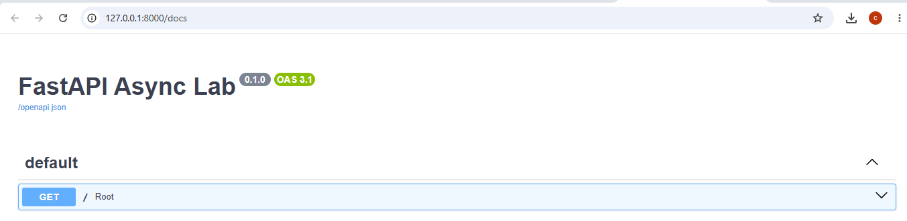
  </a>

Рисунок 1 - Главная страница Swagger UI

## Задание 2. Фоновые задачи (BackgroundTasks)

Реализован эндпоинт `POST /notify/email`. Ответ приходит мгновенно, а имитация отправки email (2 секунды) происходит в фоне. На скриншоте видно, что ответ получен сразу (<a href="#fig2.1">Рисунок 2.1</a>), а спустя время в консоли появилось сообщение об отправке (<a href="#fig2.2">Рисунок 2.2</a>).

  <a href="images/ex2.1.PNG" target="_blank">
    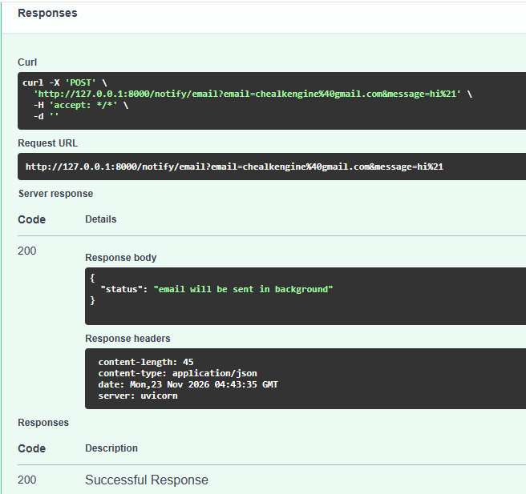
  </a>

Рисунок 2.1 - Мгновенный ответ API

  <a href="images/ex2.2.PNG" target="_blank">
    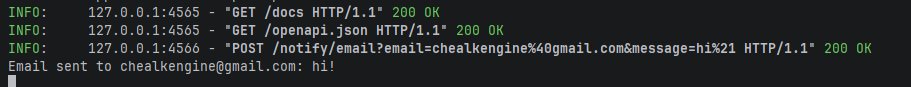
  </a>

Рисунок 2.2 - Лог отправки email в фоне

## Задание 3. Длительная задача с опросом статуса (polling)

Реализованы эндпоинты `POST /tasks/process` и `GET /tasks/{task_id}`. Клиент получает `task_id` (<a href="#fig3.1">Рисунок 3.1</a>), затем опрашивает статус, наблюдая за прогрессом (<a href="#fig3.2">Рисунок 3.2</a>) до успешного завершения (<a href="#fig3.3">Рисунок 3.3</a>). Также обрабатывается ошибка 404 для несуществующего ID (<a href="#fig3.4">Рисунок 3.4</a>).

  <a href="images/ex3.1.PNG" target="_blank">
    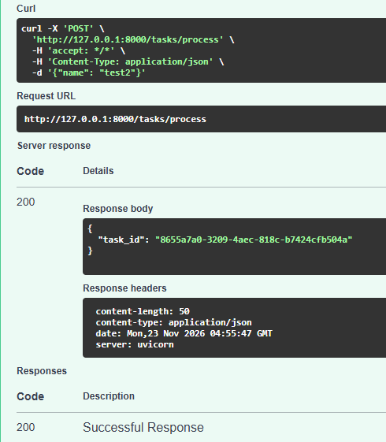
  </a>

Рисунок 3.1 - Создание задачи

  <a href="images/ex3.2.PNG" target="_blank">
    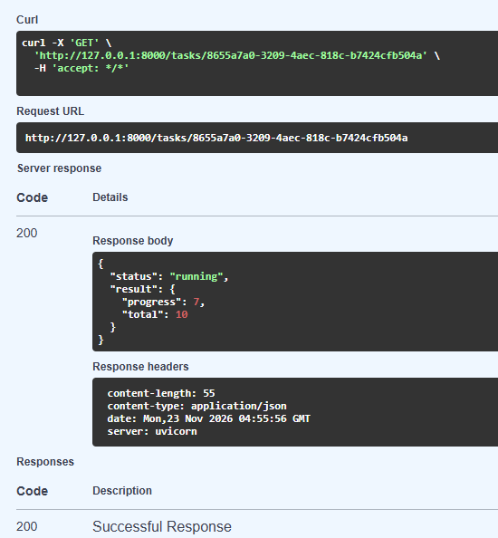
  </a>

Рисунок 3.2 - Статус running с прогрессом

  <a href="images/ex3.3.PNG" target="_blank">
    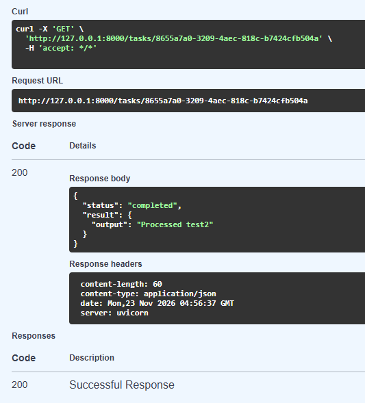
  </a>

Рисунок 3.3 - Успешное завершение задачи

  <a href="images/ex3.4.PNG" target="_blank">
    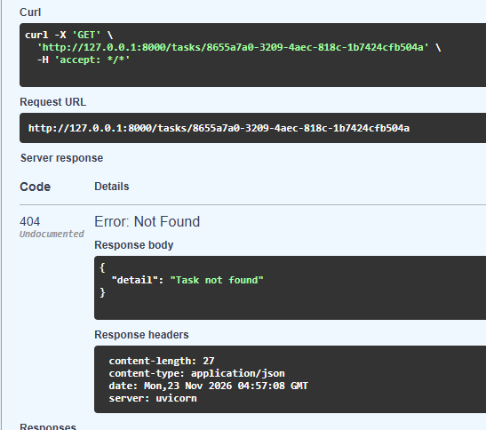
  </a>

Рисунок 3.4 - Ошибка 404 (Task not found)

## Задание 4. Запуск синхронного кода в асинхронном контексте

Реализован эндпоинт `POST /tasks/compute`. Блокирующая функция вынесена в отдельный поток через `asyncio.to_thread` (<a href="#fig4.1">Рисунок 4.1</a>). На скриншоте консоли видно, что пока выполнялся долгий запрос, сервер успешно и мгновенно отвечал на другие запросы (`GET /`) (<a href="#fig4.2">Рисунок 4.2</a>).

  <a href="images/ex4.1.PNG" target="_blank">
    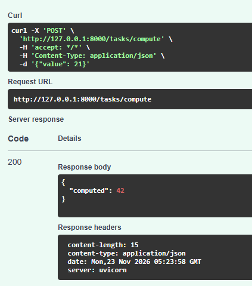
  </a>

Рисунок 4.1 - Выполнение синхронного кода

  <a href="images/ex4.2.PNG" target="_blank">
    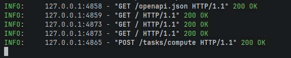
  </a>

Рисунок 4.2 - Параллельная обработка запросов (event loop не заблокирован)

## Задание 5. WebSocket для real-time обновлений

Реализован WebSocket-эндпоинт для отслеживания статуса задачи. Клиент подключился к задаче (<a href="#fig5.1">Рисунок 5.1</a>) и получал обновления прогресса каждую секунду до момента завершения (<a href="#fig5.2">Рисунок 5.2</a>).

  <a href="images/ex5.1.PNG" target="_blank">
    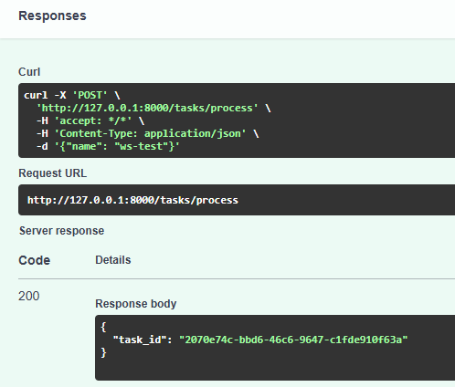
  </a>

Рисунок 5.1 - Создание задачи для WS

  <a href="images/ex5.2.PNG" target="_blank">
    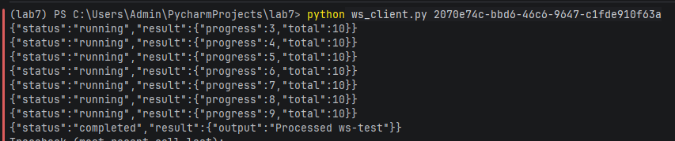
  </a>

Рисунок 5.2 - Поток сообщений от WebSocket-сервера

## Задание 6. Самостоятельная работа

### 6.1 Очередь задач
Внедрён `asyncio.Queue` и фоновый воркер. Задачи выполняются строго последовательно. Если отправить несколько запросов подряд (<a href="#fig6.1">Рисунок 6.1</a>), они не запускаются одновременно, а ждут своей очереди в статусе `pending` (<a href="#fig6.2">Рисунок 6.2</a>).

  <a href="images/ex6.1.PNG" target="_blank">
    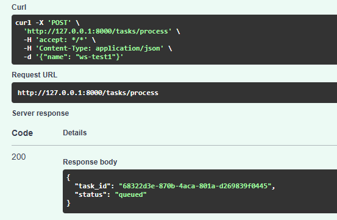
  </a>

Рисунок 6.1 - Постановка задачи в очередь

  <a href="images/ex6.2.PNG" target="_blank">
    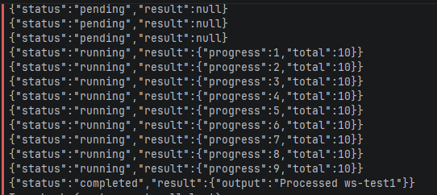
  </a>

Рисунок 6.2 - Задачи ожидают своей очереди

### 6.2 Callback-уведомления
В запрос добавлено опциональное поле `callback_url` (<a href="#fig7.1">Рисунок 7.1</a>). После завершения задачи сервер отправляет POST-запрос с результатом. На скриншотах показан успешный запрос в логах (<a href="#fig7.2">Рисунок 7.2</a>), получение данных на webhook.site (<a href="#fig7.3">Рисунок 7.3</a>) и обработка ошибок с тремя попытками (<a href="#fig7.4">Рисунок 7.4</a>).

  <a href="images/ex7.1.PNG" target="_blank">
    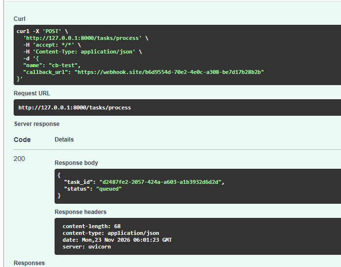
  </a>

Рисунок 7.1 - Создание задачи с callback_url

  <a href="images/ex7.2.PNG" target="_blank">
    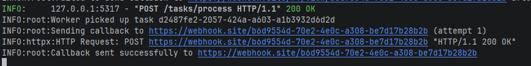
  </a>

Рисунок 7.2 - Успешная отправка callback (200 OK)

  <a href="images/ex7.3.PNG" target="_blank">
    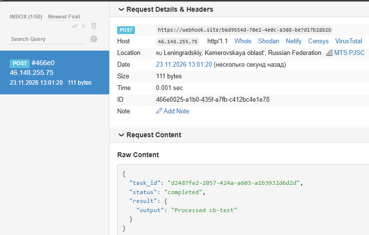
  </a>

Рисунок 7.3 - Получение уведомления на webhook.site

  <a href="images/ex7.4.PNG" target="_blank">
    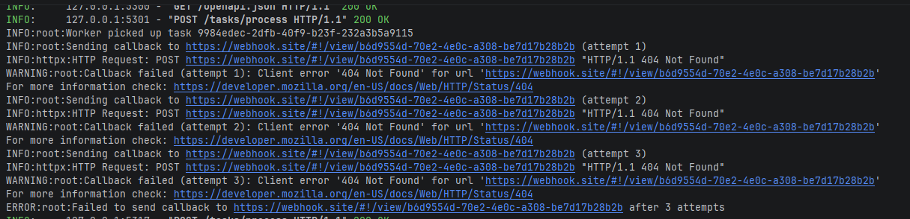
  </a>

Рисунок 7.4 - Обработка ошибки и повторные попытки (retries)

### 6.3 Логирование
Настроено структурированное логирование с указанием даты, времени, уровня и имени модуля. Логируются создание задач, изменение статуса, завершение, ошибки и подключения WebSocket (<a href="#fig8.1">Рисунок 8.1</a>, <a href="#fig8.2">Рисунок 8.2</a>).

  <a href="images/ex8.1.PNG" target="_blank">
    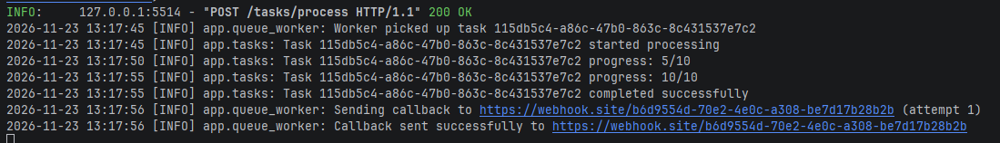
  </a>

Рисунок 8.1 - Структурированные логи приложения

  <a href="images/ex8.2.PNG" target="_blank">
    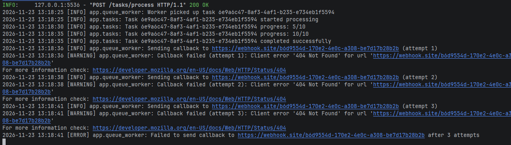
  </a>

Рисунок 8.2 - Логи с указанием уровня WARNING и ERROR

### 6.4 Улучшение хранилища задач (Redis)
Хранилище в памяти заменено на Redis. Настроено автоматическое удаление старых задач через TTL. На скриншотах показан лог успешной работы с Redis (<a href="#fig9.1">Рисунок 9.1</a>) и проверка TTL задачи (<a href="#fig9.2">Рисунок 9.2</a>).

  <a href="images/ex9.1.PNG" target="_blank">
    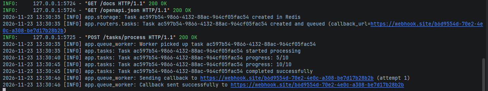
  </a>

Рисунок 9.1 - Логирование операций с Redis

  <a href="images/ex9.2.PNG" target="_blank">
    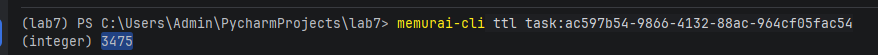
  </a>

Рисунок 9.2 - Проверка TTL задачи в Redis

## Вывод

В ходе выполнения лабораторной работы были изучены механизмы асинхронной работы в FastAPI. 

Освоено использование `BackgroundTasks` для фоновых операций, реализован паттерн длительных задач с опросом статуса (polling) и real-time обновления через WebSocket. Изучено применение `asyncio.to_thread` для безопасного вызова блокирующего кода. 

В самостоятельной части была реализована очередь задач на базе `asyncio.Queue` с последовательным воркером, настроены callback-уведомления с логикой повторных попыток, внедрено структурированное логирование, а локальное хранилище успешно заменено на Redis с поддержкой TTL.